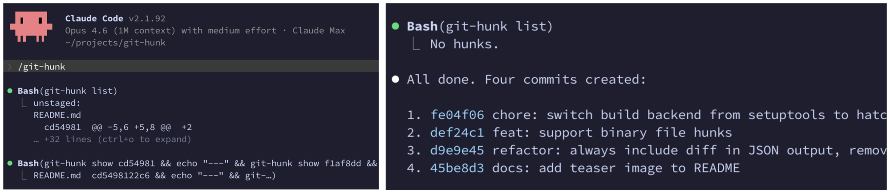

# git-hunk

[](https://pypi.org/project/git-hunk/)
[](https://pypi.org/project/git-hunk/)
[](https://pypi.org/project/git-hunk/)
[](https://github.com/wkentaro/git-hunk/actions/workflows/test.yml)

Non-interactive, programmatic alternative to `git add -p`.

Every staged or unstaged Hunk gets a durable ID, so you can inspect, filter,
and stage changes without interactive prompts. Duplicate Hunks get unique
Conditional IDs.



[Comparison](#comparison) • [Install](#install) • [For AI agents](#for-ai-agents) •
[Quick start](#quick-start) • [Usage](#usage) • [JSON output](#json-output)

## Why?

`git add -p` asks a question for every hunk, so these callers cannot use it:

- AI agents (Claude Code, Codex, and others) that split changes into logical commits
- Scripts and CI jobs that organize commits
- Editor integrations that want hunk-level staging without running a TUI

`git-hunk` gives each staged or unstaged Hunk a durable ID and takes those IDs
as arguments to `stage`, `unstage`, `discard`, and `commit`.

## Comparison

| | Interactive | Programmatic | Hunk IDs | Line-level control | JSON output |
| ---------------- | ----------- | ------------ | -------- | ------------------ | ----------- |
| `git add -p` | Yes | No | No | Yes | No |
| `git add <file>` | No | Yes | No | No | No |
| **`git-hunk`** | No | Yes | Yes | Yes | Yes |

### Eval

Claude Code 2.1.301 attempted the same eight tasks from identical repository
state, five times per variant, with three model and reasoning effort settings.
Each task asks the agent to organize a dirty working tree into correct, focused
commits, once following git-hunk's bundled skills and once restricted to bare
Git. The
[checked-in eval harness](https://github.com/wkentaro/git-hunk/tree/0f610be/eval)
grades the exact resulting repository state: commit partition and order, final
tree, index, and leftovers. This table records the qualifying run.
`just eval --model <id> --effort <level> --repeat 5` reruns one setting and
prints a table with turns and cost added.

| Task | `claude-sonnet-5` high: git-hunk | bare Git | `claude-sonnet-5-5` medium: git-hunk | bare Git | `claude-opus-5-5` medium: git-hunk | bare Git |
| --- | --- | --- | --- | --- | --- | --- |
| [split_refactor_vs_feature](https://github.com/wkentaro/git-hunk/blob/0f610be/eval/tasks/split_refactor_vs_feature.py) | 5/5 · 3c [2-5] | 5/5 · 3c | 5/5 · 2c | 5/5 · 2c | 5/5 · 2c | 5/5 · 2c |
| [separate_mixed_hunks](https://github.com/wkentaro/git-hunk/blob/0f610be/eval/tasks/separate_mixed_hunks.py) | 5/5 · 3c [2-3] | 5/5 · 7c [5-13] | 5/5 · 2c | **4/5** · 2c [2-3] | 5/5 · 2c [2-5] | **4/5** · 2c [2-4] |
| [drop_debug_lines](https://github.com/wkentaro/git-hunk/blob/0f610be/eval/tasks/drop_debug_lines.py) | 5/5 · 3c [2-5] | 5/5 · 6c [4-10] | 5/5 · 2c [2-3] | 5/5 · 3c [2-3] | 5/5 · 2c [2-4] | 5/5 · 3c |
| [protect_unrelated_work](https://github.com/wkentaro/git-hunk/blob/0f610be/eval/tasks/protect_unrelated_work.py) | 5/5 · 2c [2-4] | 5/5 · 2c | 5/5 · 2c | 5/5 · 2c | 5/5 · 2c | 5/5 · 2c |
| [split_single_hunk](https://github.com/wkentaro/git-hunk/blob/0f610be/eval/tasks/split_single_hunk.py) | 5/5 · 4c [3-7] | 5/5 · 6c [4-33] | 5/5 · 3c | 5/5 · 2c | 5/5 · 2c | 5/5 · 2c [2-3] |
| [separate_formatter_noise](https://github.com/wkentaro/git-hunk/blob/0f610be/eval/tasks/separate_formatter_noise.py) | 5/5 · 4c [3-5] | 5/5 · 11c [9-13] | 5/5 · 2c [2-3] | 5/5 · 2c [2-4] | 5/5 · 2c [2-3] | 5/5 · 4c [2-7] |
| [pick_duplicate_hunk](https://github.com/wkentaro/git-hunk/blob/0f610be/eval/tasks/pick_duplicate_hunk.py) | 5/5 · 3c [2-4] | 5/5 · 4c [4-23] | 5/5 · 2c | **1/5** · 2c [2-3] | 5/5 · 2c | 5/5 · 3c [2-3] |
| [commit_parseable_subset](https://github.com/wkentaro/git-hunk/blob/0f610be/eval/tasks/commit_parseable_subset.py) | 5/5 · 4c [3-6] | 5/5 · 9c [6-11] | 5/5 · 2c [2-3] | 5/5 · 2c [2-3] | 5/5 · 2c | 5/5 · 3c [2-3] |
| **total** | 8/8 · 26c [19-39] | 8/8 · 48c [37-108] | 8/8 · 17c [17-20] | 6/8 (2 mixed) · 17c [16-22] | 8/8 · 16c [16-22] | 7/8 (1 mixed) · 21c [17-27] |

A cell gives the passing repeats and the median tool calls, with the observed
range in brackets when the repeats disagreed. Turns are always one more than
calls, so the table leaves them out. **Bold** marks a variant that failed a
repeat. Every failure was `partition`: the agent made no commit, so the commits
did not match the required change groups.

git-hunk passed all 120 of its runs. Bare Git failed 6 of 120, five of them
on `claude-sonnet-5-5`. git-hunk saves the most calls with `claude-sonnet-5` at
high effort, the setting that explores most. With `claude-sonnet-5-5` at medium
effort, both variants take about the same number of calls. The table omits
cost because the runs overlapped and shared the prompt cache, so costs are not
comparable between variants
([ADR 0005](https://github.com/wkentaro/git-hunk/blob/main/docs/adr/0005-eval-publication-bar.md)). Five samples per task
variant, dated 2026-10-17 at commit `0f610be`.

## Install

Requires Git 2.28 or later. `git-hunk` forces canonical diff paths with
`git diff --no-relative`, which earlier versions of Git do not accept.

```bash
pip install git-hunk
```

Or with [uv](https://docs.astral.sh/uv/):

```bash
uv tool install git-hunk
```

Verify it works:

```bash
git-hunk --version
```

> [!TIP]
> To try the head of `main` before it reaches PyPI:
>
> ```bash
> uv tool install git+https://github.com/wkentaro/git-hunk
> ```

### For AI agents

The CLI ships its own usage guide, so an agent (Claude Code, Codex, and
others) can load it on demand. The guide always matches the installed version:

```bash
git-hunk skills get core
```

`core` covers the commands. The optional `logical-commits` skill covers how to
group hunks into commits and order them. A project with its own commit
conventions can load `core` alone:

```bash
git-hunk skills                           # list available skills
git-hunk skills get core logical-commits  # load both
```

Before committing the working tree, an agent can load the skills and the
tree's hunks in one call and plan from that output:

```bash
git-hunk skills get core logical-commits && git-hunk list && git-hunk show
```

`git-hunk --help` also tells agents to start with `git-hunk skills get core`.

## Quick start

```bash
# See all hunks across staged, unstaged, and untracked files
git-hunk list

# Show the diff for a specific hunk
git-hunk show d161935

# Stage specific hunks, then commit
git-hunk stage d161935 a3f82c1
git commit -m "feat: add validation for user input"

# Stage the remaining hunks
git-hunk stage e7b4012
git commit -m "fix: handle empty response in API client"
```

## Usage

### Repository paths

A Repository path is relative to the worktree root, uses `/`, and means the
same file from any directory you run git-hunk in. Every path in output and every
file operand for `list`, `stage`, `unstage`, `discard`, and `commit` is a
Repository path. git-hunk normalizes a leading `./` and internal `..`
components, and rejects absolute paths and paths that leave the worktree.

A file operand selects one exact changed file. git-hunk does not expand
directories, globs, or Git pathspec syntax. Quote operands that contain shell
metacharacters so the shell passes them unchanged. For example, from `sub/`,
`same.txt` selects the file at the worktree root, and `sub/same.txt` selects the
file inside `sub/`. `show` takes Hunk IDs only.

### Unsupported repository states

git-hunk rejects detected rename, copy, and unmerged index states before it
writes output or changes the repository, so it never prints partial JSON, a
partial inventory, or a false clean result, and never applies half a change.
Resolve an unmerged index with Git, then retry. Rename and copy support is
tracked in [#53](https://github.com/wkentaro/git-hunk/issues/53).

### Hunk IDs

A canonical Hunk ID is a full SHA-256 value. JSON returns it in full. Human
output shows the shortest unambiguous prefix of at least seven characters, and
commands accept any unambiguous prefix in either case. git-hunk computes IDs
from the combined staged and unstaged inventory, even when a status filter shows
only one side.

An Unchanged Hunk keeps its ID when it moves completely between staged and
unstaged state or when other complete Hunks move. A partial-line operation
creates new Hunks with new IDs.

Hunks with the same Repository path and patch content form a Duplicate Hunk
group. Each member gets a unique Conditional Hunk ID, shown with a
`conditional` label in human output and `"id_stability": "conditional"` in JSON.
The ID can change when its Duplicate Hunk group changes. After a partial-line
operation or an operation on a Conditional Hunk ID, address anything remaining
by Repository path, which is ID-independent, or run `git-hunk list` again for
the new IDs.

### List hunks

```bash
git-hunk list                          # all hunks (unstaged + staged + untracked)
git-hunk list --unstaged               # unstaged hunks only
git-hunk list --staged                 # staged hunks only
git-hunk list src/foo.py src/bar.py    # specific files
git-hunk list --json                   # JSON output for scripting
```

### Show hunks

```bash
git-hunk show                          # show all hunks (staged + unstaged)
git-hunk show d161935                  # show a single hunk
git-hunk show d161935 a3f82c1          # show multiple hunks
git-hunk show --staged                 # show all staged hunks
git-hunk show --unstaged               # show all unstaged hunks
```

### Stage, unstage, discard

```bash
git-hunk stage d161935                 # stage a hunk
git-hunk stage d161935 a3f82c1         # stage multiple hunks
git-hunk stage d161935 -l 3,5-7        # stage specific lines only
git-hunk stage d161935 --exclude-matching debug    # stage all but lines containing "debug"
git-hunk stage d161935 --include-matching xfail    # stage only lines containing "xfail"
git-hunk unstage d161935               # move back to working tree
git-hunk unstage d161935 -l 3,5-7      # unstage specific lines only
git-hunk discard d161935               # restore from the index
git-hunk discard d161935 -l ^3,^5-7    # discard excluding specific lines
```

`--include-matching` and `--exclude-matching` select changed lines by content
instead of position. They match a literal substring, or a regular expression
with `--regex`. Both are repeatable, OR'd, and case-sensitive, and both fail if
nothing matches. Use only one of `-l`, `--include-matching`, and
`--exclude-matching`.

`-l` needs exactly one Hunk. Matching applies to every Hunk the targets select,
so a path selects matching lines across a whole file. `--include-matching`
leaves out a Hunk with no matching line, and `--exclude-matching` takes it
whole. A Hunk whose every change is excluded is left out.

Line selection accepts any subset of a pure addition or pure deletion. git-hunk
rejects one side of a one-for-one replacement, because that leaves a lone
deletion or addition. Select both lines, match text they share, or pass
`--allow-one-sided` when the lone half is what you want.

A grouped replacement has several deleted or added lines. A partial selection
of one must take every line on the side the command consumes, plus some lines
of the other side. `stage` and `commit` consume deletions, and `unstage` and
`discard` consume additions. Staging every deletion and one addition replaces
the old lines with that addition alone. git-hunk rejects any other partial
selection, because nothing says where an unselected line would land.
`--allow-one-sided` does not change this.

git-hunk checks `-l` range endpoints against the Hunk before expanding them, and
keeps each side's no-newline state. Submodule pointer changes and whole-file
Hunks have no line selection. Select them whole.

A binary, mode-only, type, or empty tracked file change is a whole-file Hunk.
Plain output labels empty tracked changes as `Empty file (added)` or
`Empty file (deleted)`. When one file has a mode change and text edits, the mode
and each text range are separate Hunks. Selecting text does not apply the mode
change, and selecting the mode Hunk does not apply text.

### Commit

```bash
git-hunk commit d161935 -m "fix: ..."      # stage a hunk and commit it in one step
git-hunk commit d161935 -l 3,5-7 -m "..."  # stage specific lines and commit
git-hunk commit d161935 --exclude-matching debug -m "..."  # commit all but matching lines
```

`commit` aborts if anything is already staged, so the commit contains exactly
the selected hunks. It accepts the same `-l`, `--include-matching`,
`--exclude-matching`, `--regex`, and `--allow-one-sided` selection options as
`stage`.

### JSON output

```bash
git-hunk list --json     # inventory: every hunk, no body
git-hunk show <id> --json # the same hunks plus a structured per-line body
```

Both emit a versioned envelope, so consumers can rely on its shape.
`schema_version` is currently `2`. `list --json` is an inventory without hunk
bodies, and `show --json` adds a structured `lines` array. Here is a
`show --json` hunk. `list --json` prints the same object without `lines`:

```json
{
  "schema_version": 2,
  "hunks": [
    {
      "id": "d161935000000000000000000000000000000000000000000000000000000000",
      "id_stability": "stable",
      "file": { "text": "src/main.py" },
      "status": "unstaged",
      "change_kind": "M",
      "a_mode": "100644",
      "b_mode": "100644",
      "binary": false,
      "header": "@@ -10,3 +10,5 @@",
      "context_before": { "text": "def main():" },
      "additions": 2,
      "deletions": 0,
      "lines": [
        { "n": 1, "op": " ", "content": { "text": "    x = 1" } },
        { "n": 2, "op": "+", "content": { "text": "    y = 2" } }
      ]
    }
  ]
}
```

| Field | Type | Description |
| ---------------- | -------------- | -------------------------------------------------------------------------------------------------------------------------------------------------------------------------------------- |
| `schema_version` | int | Envelope version; bumped on any incompatible change to the shape below. |
| `hunks` | array | The hunks (empty array when there are no changes). |
| `id` | string | Full canonical SHA-256 Hunk ID. An `untracked` entry's ID covers the file's content; it is empty only for an untracked path git-hunk cannot read, such as an embedded repository. Human output uses a unique prefix of at least seven characters. |
| `id_stability` | string | `stable` or `conditional`. An untracked inventory entry reports `stable`. |
| `file` | union | Repository path of the changed file, as a byte-safe `{text\|bytes}` union (see below). |
| `status` | string | One of `staged`, `unstaged`, `untracked`. |
| `change_kind` | string | Git status letter: `A` added, `D` deleted, `M` modified, `T` typechange (`R`/`C` reserved and currently rejected). Always present. |
| `a_mode` | string | null | 6-digit octal git mode on the pre-image side; `null` when that side does not exist. |
| `b_mode` | string | null | 6-digit octal git mode on the post-image side; `null` when that side does not exist. |
| `binary` | bool | Whether the change is binary. Always present. |
| `header` | string | null | The bare `@@ -a,b +c,d @@` range for a text hunk; `null` for a whole-file hunk (binary, mode-only, type, or empty tracked file change) or an `untracked` inventory entry. |
| `context_before` | union | null | The function/section name after a text hunk's `@@` header, as a `{text\|bytes}` union; `null` for a text hunk without a heading, a whole-file hunk, or an `untracked` inventory entry. |
| `additions` | int | Number of added lines. |
| `deletions` | int | Number of removed lines. |
| `lines` | array | `show --json` only. The structured body; `[]` for a whole-file hunk. See below. |

A `lines` entry is `{ "n", "op", "content", "no_newline"? }`:

| Field | Type | Description |
| ------------ | ------ | --------------------------------------------------------------------------------------------------- |
| `n` | int | 1-based position within the hunk body, the number `-l` takes. Counts every body line. |
| `op` | string | `" "` context, `"+"` addition, `"-"` deletion. |
| `content` | union | The line text without its leading op character, as a `{text\|bytes}` union. |
| `no_newline` | bool | Present and `true` only when the line has no trailing newline; consumes no `n`. |

Any field carrying arbitrary git/source bytes (`file`, `context_before`,
`lines[].content`) is a byte-safe `{text | bytes}` union: `{"text": "..."}` for
valid UTF-8, else `{"bytes": "<base64>"}`. It is always an object, so consumers
have one code path and strict JSON parsers never see a lone surrogate.

A new field is backward-compatible and leaves `schema_version` alone. Renaming,
removing, or retyping an existing field bumps it. Before `schema_version`
existed, `list --json` returned a bare array.

## How it works

1. Rejects detected rename, copy, and unmerged states.
2. Parses staged and unstaged `git diff` output into one combined Hunk inventory.
3. Assigns each Hunk a full canonical SHA-256 ID and a unique human prefix.
4. Gives members of a Duplicate Hunk group unique Conditional Hunk IDs.
5. For staging, reconstructs a minimal patch and pipes it through `git apply --cached`.
6. For discarding, reconstructs a reverse patch and applies it to the working tree.

Text IDs use the Repository path and patch body, including context and newline
state. They exclude `@@` ranges, section headings, and staged state. Whole-file
IDs include the actual binary, mode, or type change. An Unchanged Hunk keeps
its ID while complete Hunks move. A partial operation changes the patch content,
so the resulting Hunks get new IDs.

## Contributing

Bug reports, feature requests, and pull requests are welcome on
[GitHub](https://github.com/wkentaro/git-hunk).

Install [just](https://just.systems/man/en/packages.html) 1.58.0 or newer and
[uv](https://docs.astral.sh/uv/getting-started/installation/). Recipes use Bash.
On Windows, install Git for Windows and put its Bash on `PATH`.

```bash
git clone https://github.com/wkentaro/git-hunk.git
cd git-hunk
just setup   # install dependencies
just test    # run tests
just lint    # run linters
```

## License

MIT ([LICENSE](https://github.com/wkentaro/git-hunk/blob/main/LICENSE))
